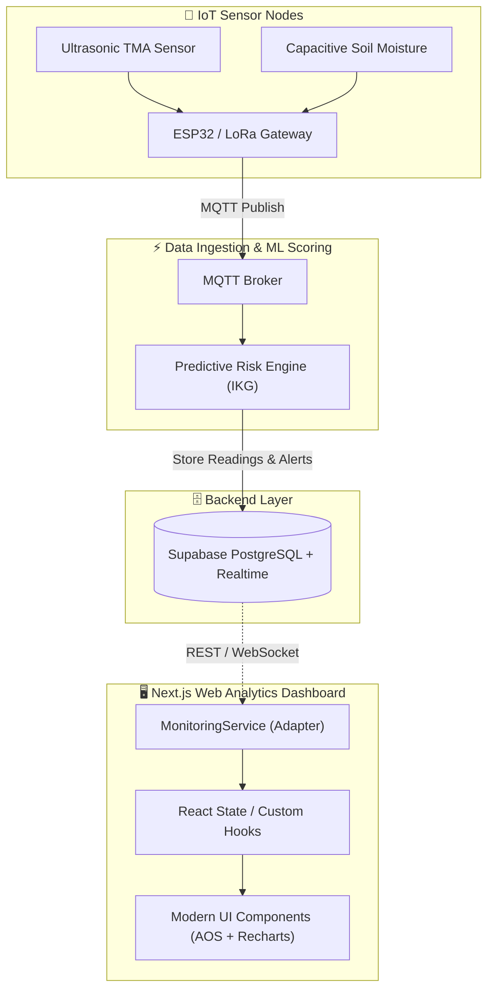

# 🌿 Peatland Hydrological Analytics Dashboard

> **Integrated IoT-Web Analytics System**  
> *Sistem Pemodelan Prediktif Hidrologi untuk Peringatan Dini Kerentanan Lahan Gambut*  
> Berbasis **Next.js 16 (App Router)**, **React 19**, **TypeScript**, dan **Tailored Forest Design System**.

---

[](https://nextjs.org/)
[](https://react.dev/)
[](https://www.typescriptlang.org/)
[](https://recharts.org/)
[](https://michalsnik.github.io/aos/)
[](#arsitektur--aliran-data)

---

## 📌 Ringkasan Proyek

Kebakaran pada lahan gambut umumnya bertipe **smoldering fire** (kebakaran bawah permukaan) yang sulit dideteksi secara visual sebelum api muncul ke permukaan. Sistem ini memindahkan paradigma penanggulangan kebakaran hutan dan lahan (Karhutla) dari **deteksi reaktif** menuju **pemantauan preventif berbasis hidrologi**.

Dashboard web ini bertindak sebagai **lapisan presentasi & analitik hilir (downstream visualization layer)** dari jaringan sensor IoT lapangan yang mengukur:
1. **Tinggi Muka Air (TMA)** gambut (dalam centimeter terhadap permukaan tanah).
2. **Kelembaban Tanah (Soil Moisture)** pada kedalaman kritis perakaran.

Data tersebut diproses oleh backend dengan algoritma pemodelan prediktif menghasilkan **Indeks Kerentanan Gambut (IKG)** dengan kategori status berjenjang:
- 🟢 **AMAN** (IKG < 40)
- 🟡 **SIAGA** (40 ≤ IKG < 70)
- 🔴 **AWAS** (IKG ≥ 70)

---
---

## 🔌 Panduan Hardware, Modul ESP32, dan Instalasi Sensor IoT

Bagian ini menjelaskan komponen perangkat keras yang digunakan dalam sistem pemantauan hidrologi lahan gambut, fungsi setiap modul, konfigurasi pin, serta prosedur pemasangan sensor.

### 1. Komponen Hardware

Sistem menggunakan ESP32 sebagai mikrokontroler utama untuk membaca data sensor, melakukan pemrosesan awal, dan mengirimkan data monitoring ke server melalui jaringan Wi-Fi.

| Komponen | Fungsi |
|---|---|
| ESP32 DevKit | Mikrokontroler utama dan komunikasi Wi-Fi |
| HC-SR04 Ultrasonic | Mengukur Tinggi Muka Air (TMA) |
| Capacitive Soil Moisture Sensor | Mengukur kelembaban tanah |
| MAX6675 + Thermocouple Type-K | Mengukur temperatur lingkungan atau tanah |
| OLED Display | Menampilkan informasi pembacaan sensor |
| DC-DC Buck Converter | Menurunkan dan menstabilkan tegangan |
| Battery | Sumber daya utama perangkat IoT |

### 2. ESP32 DevKit

ESP32 merupakan pusat kendali seluruh perangkat IoT. Modul ini memiliki kemampuan komunikasi Wi-Fi yang digunakan untuk mengirimkan data sensor menuju MQTT Broker dan backend sistem.

**Fungsi utama ESP32:**
- Membaca data dari sensor ultrasonik.
- Membaca nilai analog dari sensor kelembaban tanah.
- Membaca temperatur melalui modul MAX6675.
- Menampilkan informasi sensor melalui OLED.
- Mengirimkan data monitoring menggunakan protokol MQTT.
- Menghubungkan perangkat dengan dashboard monitoring berbasis web.

**Koneksi utama ESP32:**

ESP32 menggunakan beberapa jenis komunikasi, yaitu GPIO Digital, ADC, I2C, dan SPI.

### 3. HC-SR04 Ultrasonic Sensor (Water Level Monitoring)

HC-SR04 digunakan untuk mengukur jarak antara sensor dan permukaan air. Hasil pengukuran digunakan untuk memperoleh nilai Tinggi Muka Air (TMA) gambut.

**Prinsip kerja:**

1. Pin TRIG mengirimkan gelombang ultrasonik.
2. Gelombang dipantulkan oleh permukaan air.
3. Pin ECHO menerima pantulan gelombang.
4. ESP32 menghitung waktu perjalanan gelombang.
5. Jarak dihitung menggunakan kecepatan suara.

Rumus pengukuran:

`Distance (cm) = (Duration × 0.0343) / 2`

Nilai TMA dihitung berdasarkan posisi pemasangan sensor dan jarak hasil pengukuran:

`TMA = Tinggi Acuan - Distance`

**Konfigurasi pin:**

| HC-SR04 | ESP32 |
|---|---|
| VCC | VIN / 5V |
| GND | GND |
| TRIG | GPIO 5 |
| ECHO | GPIO 18 melalui voltage divider |

**Cara pemasangan:**

1. Pasang sensor pada bagian atas sumur pantau atau tabung pengamatan muka air.
2. Arahkan kedua transduser sensor ke permukaan air.
3. Pastikan sensor berada dalam posisi stabil dan tidak mudah bergeser.
4. Pastikan tidak terdapat penghalang antara sensor dan permukaan air.
5. Atur tinggi pemasangan sebagai titik acuan pengukuran.
6. Lindungi rangkaian elektronik dari hujan dan kelembaban berlebih.

**Catatan:** Pin ECHO HC-SR04 menghasilkan sinyal 5V, sedangkan GPIO ESP32 bekerja pada logika 3.3V. Gunakan voltage divider sebelum menghubungkannya ke ESP32 agar GPIO tidak rusak.

### 4. Capacitive Soil Moisture Sensor

Sensor capacitive soil moisture digunakan untuk mengukur tingkat kelembaban tanah gambut.

Berbeda dengan sensor resistif, sensor kapasitif memanfaatkan perubahan kapasitansi untuk mendeteksi kondisi kelembaban tanah.

**Konfigurasi pin:**

| Soil Moisture | ESP32 |
|---|---|
| VCC | 3.3V |
| GND | GND |
| AOUT | GPIO 34 (ADC) |

**Cara pemasangan:**

1. Tentukan kedalaman tanah yang akan dipantau.
2. Tancapkan bagian probe sensor ke dalam tanah gambut.
3. Pastikan bagian penginderaan sensor tertanam dengan baik.
4. Jangan menenggelamkan bagian rangkaian elektronik atau konektor.
5. Pastikan posisi sensor tidak mudah berubah akibat pergerakan tanah.
6. Lakukan kalibrasi menggunakan kondisi tanah kering dan basah.

**Kalibrasi sensor:**

Nilai ADC yang diperoleh ESP32 perlu dikonversi menjadi persentase kelembaban berdasarkan hasil kalibrasi.

Contoh rumus:

`Moisture (%) = ((Dry Value - ADC Value) / (Dry Value - Wet Value)) × 100`

Nilai kalibrasi perlu disesuaikan dengan karakteristik sensor dan jenis tanah gambut yang digunakan.

### 5. MAX6675 dan Thermocouple Type-K

Modul MAX6675 digunakan sebagai antarmuka pembacaan temperatur menggunakan sensor termokopel Type-K.

Komponen ini dapat digunakan sebagai parameter tambahan untuk memantau perubahan temperatur pada lingkungan atau tanah gambut.

**Konfigurasi pin:**

| MAX6675 | ESP32 |
|---|---|
| VCC | 3.3V |
| GND | GND |
| SCK | GPIO 14 |
| CS | GPIO 27 |
| SO | GPIO 26 |

**Cara pemasangan:**

1. Hubungkan kabel termokopel Type-K ke terminal input modul MAX6675.
2. Pasang ujung probe pada lokasi pengukuran temperatur.
3. Pastikan ujung probe berada pada titik pengukuran yang diinginkan.
4. Hubungkan modul MAX6675 ke ESP32 sesuai konfigurasi pin.
5. Baca temperatur melalui komunikasi SPI.

**Catatan:** MAX6675 merupakan sensor tambahan pada konfigurasi ini. Penggunaannya sebagai bagian dari perhitungan IKG harus disesuaikan dengan formulasi model penelitian.

### 6. OLED Display

OLED digunakan sebagai antarmuka lokal untuk menampilkan hasil pembacaan sensor tanpa harus membuka dashboard web.

Informasi yang dapat ditampilkan:
- Tinggi Muka Air (TMA).
- Kelembaban tanah.
- Temperatur.
- Status koneksi perangkat.
- Status kerentanan lahan gambut.

**Konfigurasi pin I2C:**

| OLED | ESP32 |
|---|---|
| VCC | 3.3V |
| GND | GND |
| SDA | GPIO 21 |
| SCL | GPIO 22 |

OLED menggunakan komunikasi I2C sehingga hanya membutuhkan dua pin komunikasi utama.

### 7. Battery dan DC-DC Buck Converter

Battery digunakan sebagai sumber energi utama perangkat IoT. Tegangan dari baterai perlu disesuaikan sebelum digunakan oleh ESP32 dan sensor.

DC-DC buck converter berfungsi menurunkan tegangan baterai menjadi tegangan yang sesuai dengan kebutuhan rangkaian.

**Prosedur pemasangan:**

1. Hubungkan terminal positif baterai ke input positif buck converter.
2. Hubungkan terminal negatif baterai ke input negatif buck converter.
3. Atur tegangan output menggunakan multimeter sebelum menghubungkan perangkat.
4. Hubungkan output regulator ke jalur suplai perangkat sesuai kebutuhan tegangan.
5. Pastikan seluruh rangkaian menggunakan ground yang sama.

**Catatan keselamatan:**
- Jangan menghubungkan baterai langsung ke pin 3.3V ESP32 tanpa regulator yang sesuai.
- Periksa polaritas positif dan negatif sebelum mengaktifkan rangkaian.
- Gunakan rangkaian proteksi baterai dan charger yang sesuai dengan jenis baterai.
- Pastikan tegangan output buck converter sesuai dengan spesifikasi setiap modul.

### 8. Tabel Keseluruhan Konfigurasi Pin ESP32

Berikut merupakan rekomendasi konfigurasi pin untuk ESP32 DevKit berdasarkan jenis sensor dan modul yang digunakan.

| Perangkat | Pin ESP32 | Jenis Komunikasi |
|---|---|---|
| HC-SR04 TRIG | GPIO 5 | Digital Output |
| HC-SR04 ECHO | GPIO 18 | Digital Input (3.3V melalui divider) |
| Soil Moisture AOUT | GPIO 34 | Analog Input |
| MAX6675 SCK | GPIO 14 | SPI Clock |
| MAX6675 CS | GPIO 27 | SPI Chip Select |
| MAX6675 SO | GPIO 26 | SPI Data |
| OLED SDA | GPIO 21 | I2C Data |
| OLED SCL | GPIO 22 | I2C Clock |

**Penting:** Tabel tersebut merupakan rekomendasi pemetaan pin untuk ESP32 DevKit standar, bukan pembacaan pin pasti dari ilustrasi rangkaian. Pastikan kembali kesesuaian pin dengan board dan program firmware yang digunakan.

### 9. Prosedur Instalasi Perangkat di Lapangan

Pemasangan perangkat IoT dilakukan melalui beberapa tahapan berikut:

1. **Persiapan perangkat:** Siapkan ESP32, sensor ultrasonik, sensor kelembaban tanah, modul pendukung, kabel jumper, baterai, dan pelindung rangkaian.
2. **Perakitan elektronik:** Hubungkan seluruh sensor ke ESP32 sesuai tabel konfigurasi pin.
3. **Pengujian sensor:** Lakukan pengujian masing-masing sensor menggunakan Arduino IDE.
4. **Kalibrasi:** Sesuaikan pembacaan sensor dengan kondisi aktual di lapangan.
5. **Instalasi sensor:** Pasang sensor TMA pada sumur pantau dan sensor kelembaban pada kedalaman tanah yang ditentukan.
6. **Pengujian komunikasi:** Pastikan ESP32 dapat terhubung ke Wi-Fi dan mengirimkan data melalui MQTT.
7. **Monitoring:** Periksa data yang diterima backend dan pastikan visualisasi dashboard berjalan dengan baik.

### 10. Alur Kerja Sistem Hardware

Secara keseluruhan, proses kerja perangkat IoT adalah sebagai berikut:

1. Sensor melakukan pembacaan kondisi hidrologi lahan gambut.
2. ESP32 menerima dan memproses data hasil pembacaan sensor.
3. Data dikirimkan menuju MQTT Broker melalui jaringan Wi-Fi.
4. Backend melakukan pengolahan data dan perhitungan Indeks Kerentanan Gambut (IKG).
5. Data disimpan pada Supabase PostgreSQL.
6. Dashboard menampilkan hasil monitoring dan status peringatan dini secara real-time.

Dengan integrasi tersebut, perangkat IoT berfungsi sebagai lapisan akuisisi data lapangan yang mendukung sistem pemantauan dan peringatan dini kebakaran lahan gambut.

---


---

## ✨ Fitur Utama

### 🌲 1. Forest Premium Design System (Anti-AI Slop)
- **Tema Visual Organik Hutan**: Palet hijau lumut tua (`#0a0f0a`, `#111a12`), border subtil berbasis alpha transparan, dan efek glassmorphism yang presisi.
- **Tipografi Berkelas**:
  - `Outfit`: Display & header utama berkarakter modern dan tegas.
  - `Inter`: Teks antarmuka dengan keterbacaan tinggi.
  - `JetBrains Mono`: Penyajian angka metrik telemetri, koordinat sensor, dan ID node.
- **Micro-interactions & AOS Animations**: Staggered scroll animations, pulse rings pada status node aktif, serta transisi hover yang halus.

### 🌗 2. Dark & Light Mode dengan Zero-Flicker
- Toggle tema di header dan sidebar dengan dukungan auto-detect preferensi OS (`prefers-color-scheme`).
- Anti-flash script inline di `<head>` untuk mencegah efek *flicker* saat pemuatan halaman pertama kali.
- Penyimpanan status tema persisten pada `localStorage`.

### 📊 3. Analitik Interaktif & Monitoring Hidrologi
- **Area & Line Charts (Recharts)** dengan custom linear gradients dan rich interactive tooltips.
- **Water Level Gauge**: Representasi visual level air terhadap ambang batas kritis gambut (-40 cm).
- **Segmented Soil Moisture Bar**: 4 zona kelembaban terintegrasi (*Kering*, *Rendah*, *Normal*, *Lembab*).
- **Timeframe Selector**: Filter data rentang 24 Jam, 7 Hari, dan 30 Hari secara reaktif.

### 🛡️ 4. Early Warning System (Alert Center)
- Pusat notifikasi peringatan dini dengan klasifikasi prioritas tingkat bahaya (**AWAS**, **SIAGA**, **AMAN**).
- Fitur konfirmasi (Acknowledge alert) dan filter status aktif/arsip.

### 📡 5. Fleet Monitoring Multi-Node
- Daftar inventaris seluruh stasiun node sensor IoT di berbagai blok gambut.
- Indikator status jaringan real-time (`ONLINE` / `OFFLINE` / `UNKNOWN`), level baterai, koordinat GPS, dan timestamp telemetri terakhir.
- Halaman detail komprehensif per node (`/monitoring/[nodeId]`) dilengkapi histori pembacaan sensor.

### 📱 6. Desain Ultra-Responsif
- **Desktop (>1024px)**: Layout sidebar 240px dengan dashboard grid multi-kolom.
- **Tablet (768px - 1024px)**: Grid 2-kolom dengan penyusutan proporsional.
- **Mobile (≤768px)**: Off-canvas drawer menu, tombol hamburger ramah sentuhan, dan susunan kartu tumpuk vertikal satu kolom.

---

## 🏛️ Arsitektur & Aliran Data

Frontend dibangun dengan prinsip **Presentation-First & Backend Adapter Pattern** sesuai spesifikasi dokumen [arsitektur.md](../arsitektur.md):



### Keunggulan Arsitektur:
1. **Decoupled dari Database**: Komponen UI tidak bergantung langsung pada nama tabel, query SQL, atau schema Supabase.
2. **Interface Domain Bersih**: Seluruh data yang mengalir ke komponen UI mengacu pada tipe kontrak di `src/types/domain.ts`.
3. **Plug-and-Play Backend**: Tim backend dapat mengganti `mocks/mockData.ts` dengan Supabase Client resmi hanya dengan mengedit implementasi di `src/features/monitoring/services/monitoringService.ts`.

---

## 📂 Struktur Direktori

```text
peatland-dashboard/
├── public/                     # Static assets & favicon
├── src/
│   ├── app/                    # Next.js App Router
│   │   ├── alerts/             # Halaman Alert Center
│   │   ├── dashboard/          # Alias / Redirect ke root dashboard
│   │   ├── monitoring/         # Fleet monitoring & [nodeId] dynamic route
│   │   ├── globals.css         # Forest design system, tokens, CSS variables
│   │   ├── layout.tsx          # Root layout & providers
│   │   └── page.tsx            # Main executive dashboard
│   ├── components/
│   │   ├── alerts/             # AlertsClient & item components
│   │   ├── charts/             # AreaChart, LineChart, ChartSkeleton
│   │   ├── dashboard/          # Metric cards (WaterLevel, SoilMoisture, RiskSummary)
│   │   ├── layout/             # AppLayout, Sidebar, AppHeader
│   │   ├── monitoring/         # MonitoringClient, NodeDetailClient, NodeCard
│   │   ├── providers/          # AOS Provider & Theme context
│   │   ├── status/             # StatusBadge, ConnectionStatus
│   │   └── ui/                 # Skeletons, ErrorState, EmptyState
│   ├── features/
│   │   └── monitoring/
│   │       └── services/       # monitoringService.ts (Backend Adapter Layer)
│   ├── lib/
│   │   └── constants/          # App constants, risk thresholds, formatter helpers
│   ├── mocks/
│   │   └── mockData.ts         # Realistic mock dataset (Nodes, Readings, Trends, Alerts)
│   └── types/
│       └── domain.ts           # Domain contract types (RiskStatus, MonitoringReading, dll)
├── package.json
├── tsconfig.json
└── README.md
```

---

## 🚀 Panduan Memulai (Getting Started)

### Prasyarat
- **Node.js**: Versi `18.18.0` atau yang lebih baru (disarankan LTS `v20.x`)
- **Package Manager**: `npm`, `pnpm`, atau `yarn`

### Instalasi & Menjalankan Lokal

1. **Clone repositori**:
   ```bash
   git clone https://github.com/username/LPPM-Peatland-Analytics.git
   cd LPPM-Peatland-Analytics/peatland-dashboard
   ```

2. **Pasang dependensi**:
   ```bash
   npm install
   ```

3. **Jalankan development server**:
   ```bash
   npm run dev
   ```

4. **Buka di peramban**:
   Akses [http://localhost:3000](http://localhost:3000) untuk melihat antarmuka dashboard.

---

## 🛠️ Perintah Skrip Tersedia

| Skrip | Deskripsi |
|---|---|
| `npm run dev` | Menjalankan Next.js development server pada port 3000 |
| `npm run build` | Melakukan kompilasi produksi aplikasi |
| `npm run start` | Menjalankan server aplikasi hasil build produksi |
| `npm run lint` | Menjalankan pemeriksaan linter ESLint |

---

## 🔌 Panduan Integrasi Backend (Supabase / Live API)

Untuk menghubungkan dashboard dengan database Supabase atau backend live:

1. **Pasang Supabase JS SDK** (opsional):
   ```bash
   npm install @supabase/supabase-js
   ```

2. **Atur Environment Variables** pada file `.env.local`:
   ```env
   NEXT_PUBLIC_SUPABASE_URL=https://your-project.supabase.co
   NEXT_PUBLIC_SUPABASE_ANON_KEY=your-anon-key
   NEXT_PUBLIC_USE_MOCK_DATA=false
   ```

3. **Sesuaikan Adapter Service**:
   Buka file `src/features/monitoring/services/monitoringService.ts`. Ubah fungsi pengambilan data agar melakukan query langsung ke Supabase atau REST API tanpa perlu menyentuh komponen UI:
   ```typescript
   export const monitoringService = {
     async getSystemStatus(): Promise<SystemStatus> {
       if (process.env.NEXT_PUBLIC_USE_MOCK_DATA === "true") {
         return mockSystemStatus;
       }
       // Hubungkan dengan Supabase client di sini:
       // const { data } = await supabase.from('system_health').select('*').single();
       // return mapToSystemStatus(data);
     },
     // ...
   };
   ```

---

## 📐 Klasifikasi Indeks Risiko & Ambang Batas

Berdasarkan formulasi riset hidrologi gambut:

| Status | Rentang IKG | Parameter TMA | Kelembaban Tanah | Rekomendasi Lapangan |
|---|---|---|---|---|
| 🟢 **AMAN** | `0 - 39` | > -20 cm | > 60% | Kondisi hidrologi basah terjaga; pemantauan rutin standar. |
| 🟡 **SIAGA** | `40 - 69` | -20 s/d -40 cm | 40% - 60% | Muka air menyusut mendekati batas kritis; patroli MPA diintensifkan. |
| 🔴 **AWAS** | `≥ 70` | < -40 cm | < 40% | Gambut kering rentan menyala; lakukan pembasahan (re-wetting) & siaga regu pemadam. |

---

## 👥 Tim & Kontribusi

Proyek ini dikembangkan dalam lingkup penelitian dan pengabdian LPPM untuk pemantauan mitigasi risiko bencana kebakaran hutan dan lahan gambut tropis.

- **Frontend Development**: Next.js & UI/UX Forest Analytics Team
- **IoT & Sensor Ingestion**: Hardware & Telemetry Division
- **Predictive Modeling**: LPPM Peatland Research Group

---

## 📄 Lisensi

Hak Cipta © 2026 Tim Peneliti LPPM. Seluruh hak cipta dilindungi undang-undang.
